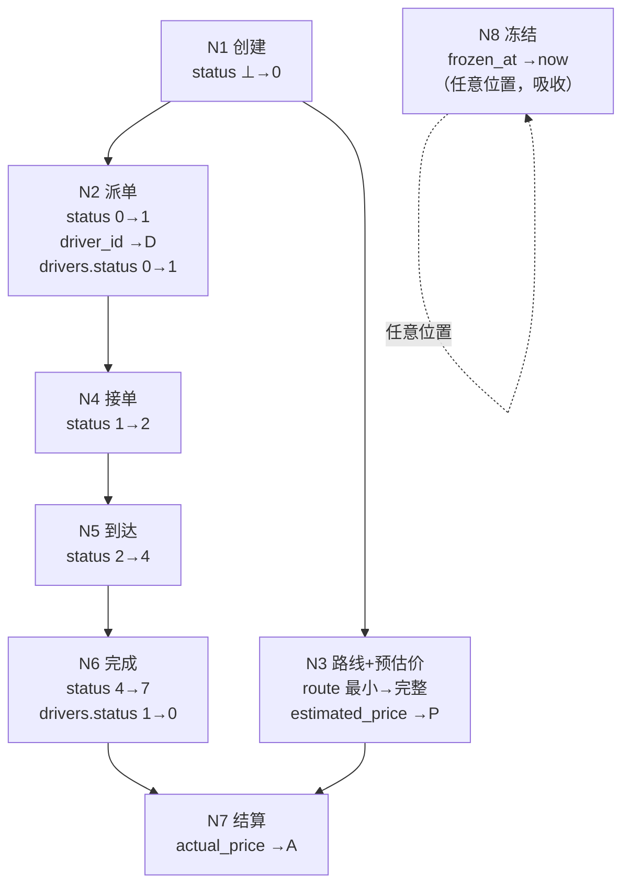

# 订单流程：字段迁移图（规格 v1）

> 范围：只管流程数据的时序与派生一致性。不写库的操作不进图。

## 一、节点定义

| # | 节点 | 字段迁移 | 守卫 | 逆变换 | 副作用 | 跨主体 |
|---|---|---|---|---|---|---|
| N1 | 创建 | `orders.status: ⊥→0`<br>`order_detail.route_snapshot: ⊥→最小`<br>5 个配置字段 `⊥→值` | 乘客无进行中订单（唯一索引） | 删两行 | — | — |
| N2 | 派单 | `orders.status: 0→1`<br>`orders.driver_id: null→D`<br>`drivers.status: 0→1` | `status=0`<br>`driver_id IS NULL`<br>`drivers.status=0`<br>`frozen_at IS NULL` | `1→0`, `D→null`, `1→0` | — | 是 |
| N3 | 路线+预估价 | `route_snapshot: 最小→完整`<br>`estimated_price: null→P` | `route_snapshot IS NOT NULL`<br>`estimated_price IS NULL`<br>`frozen_at IS NULL` | `完整→最小`<br>`P→null` | — | — |
| N4 | 接单 | `orders.status: 1→2` | `status=1`<br>`frozen_at IS NULL` | `2→1` | — | — |
| N5 | 到达 | `orders.status: 2→4` | `status=2`<br>`frozen_at IS NULL` | `4→2` | — | — |
| N6 | 完成 | `orders.status: 4→7`<br>`drivers.status: 1→0` | `status=4`<br>`drivers.status=1`<br>`frozen_at IS NULL` | `7→4`, `0→1` | — | 是 |
| N7 | 结算 | `actual_price: null→A` | `status=7`<br>`estimated_price IS NOT NULL`<br>`actual_price IS NULL`<br>`frozen_at IS NULL` | `A→null` | — | — |
| N8 | 冻结 | `orders.frozen_at: null→now` | `frozen_at IS NULL` | **无（吸收）** | 释放已占资源 | — |

## 二、依赖关系（从守卫读出来）

> 规则：**B 的守卫里引用了 A 写的字段 ⇒ 边 A→B**。依赖不单独维护，它就是守卫。

| 边 | 依据（B 的守卫引用了 A 的字段） |
|---|---|
| N1 → N2 | `status`（N1 写，N2 查 =0） |
| N1 → N3 | `route_snapshot`（N1 写，N3 查非空） |
| N2 → N4 | `status`（N2 写 =1，N4 查 =1） |
| N4 → N5 | `status`（N4 写 =2，N5 查 =2） |
| N5 → N6 | `status`（N5 写 =4，N6 查 =4） |
| N6 → N7 | `status`（N6 写 =7，N7 查 =7） |
| N3 → N7 | `estimated_price`（N3 写，N7 查非空） |
| N8 | 无前置（只查自己） |

## 三、偏序图



```
N1 创建
 ├─► N2 派单 ──► N4 接单 ──► N5 到达 ──► N6 完成 ─┐
 │                                                  ├─► N7 结算
 └─► N3 路线+预估价 ────────────────────────────────┘

N8 冻结：无前置，可作用于任意位置，吸收
```

## 四、字段清单（7 个流程字段）

| 字段 | 谁写 | 谁读 |
|---|---|---|
| `orders.status` | N1 N2 N4 N5 N6 | N2 N4 N5 N6 N7 |
| `orders.driver_id` | N2 | （仅资源对账） |
| `orders.frozen_at` | N8 | 全部节点 |
| `order_detail.route_snapshot` | N1 N3 | N3 N7 |
| `order_detail.estimated_price` | N3 | N7 |
| `order_detail.actual_price` | N7 | （仅报表） |
| `drivers.status` | N2 N6 | N2 N6 |

## 五、三个结构发现

### ① N3（路线+预估价）完全独立于状态链

它只依赖 N1（拿到起终点），**不依赖派单**。

含义：
- 乘客下单后立刻可以算路线和预估价（体验更好）
- N3 与 N2/N4/N5/N6 全部并行

### ② 重派（回溯 N2）**不需要清路线和价格**

因为 N3 不在 N2 的后继里（N3 由 N1 派生，不由 N2 派生）。

> 现在实现里"重派补偿清空 route/price"是**多余的** —— 路线只与起终点有关，不随司机变。

### ③ 冻结是唯一"没有前置"的节点

它只看 `frozen_at IS NULL`，所以在任意位置都能执行，不需要为"从哪个状态取消"定义节点。

## 六、图表达不了的：3 条断言

| # | 断言 | 为什么图表达不了 |
|---|---|---|
| A1 | `driver_id ≠ null ⇔ drivers.status = 1` | 跨主体，两个字段必须同时成立 |
| A2 | 结算后 `route_snapshot` 不得被回退 | 功能上由 N3→N7 的边保证（回溯 N3 时 N7 先撤），但**需要逆拓扑序**执行 |
| A3 | 冻结后不得有任何写入 | 由共享守卫 `frozen_at IS NULL` 保证（已在每个节点里），但需要巡检确认没有节点漏写 |

## 七、回溯的执行规则（必须明确）

```
回溯到 N_k 刚完成的状态：
1. 取 R = { 所有已执行节点 } ∩ { N_k 的所有后继 }
2. 按逆拓扑序（后继先于前置）逐个执行逆变换
3. 任何一步失败 → 停止并告警（不可部分回退）
```

**逆拓扑序是硬要求**：先撤 N7（结算）才能撤 N3（路线），否则会出现"价格没了但实收价还在"。

## 八、冻结的副作用规则

```
冻结(N_k 位置)：
1. 写 frozen_at = now（唯一字段迁移）
2. 扫描已执行节点，回收其占用的外部资源：
   - N2 已执行 → drivers.status: 1→0
   - N6 已执行 → 司机已释放，无事可做
3. 不撤销任何数据字段
```

**冻结 = 资源回收，不做数据回退。** 数据保留即历史。

## 九、总览

| 项 | 数量 |
|---|---|
| 节点 | 8（7 前进 + 1 冻结） |
| 边 | 7 |
| 流程字段 | 7 |
| 并行对 | N3 ∥ {N2, N4, N5, N6} |
| 汇合点 | N7（需 N3 + N6） |
| 跨主体节点 | 2（N2、N6） |
| 独立断言 | 3 |
| 删除的旧字段 | `orders.active_flag`、`order_detail.data_stage` |
| 删除的旧节点 | 三个取消节点（合并为冻结） |